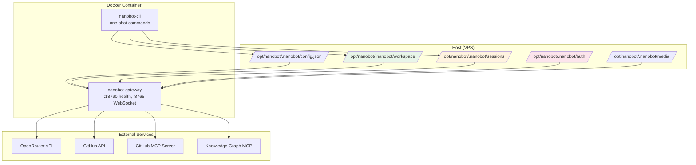

# Nanobot Instance Management Guide

This guide covers the key operational topics for managing your self-hosted nanobot instance deployed via the vps-iac Ansible playbook.

---

## Table of Contents

1. [Why Conversation History Is Lost During Image Updates](#1-why-conversation-history-is-lost-during-image-updates)
2. [Workspaces and Project Workspaces](#2-workspaces-and-project-workspaces)
3. [Graph-Based Notes / Knowledge Graph](#3-graph-based-notes--knowledge-graph)
4. [Backup Strategy](#4-backup-strategy)
5. [GitHub Access via MCP](#5-github-access-via-mcp)
6. [Quick Reference: Data Locations](#6-quick-reference-data-locations)

---

## 1. Why Conversation History Is Lost During Image Updates

### The Short Answer

**Your conversation history is NOT lost during image updates — if your bind mounts are correct.**

In your current vps-iac setup (`roles/nanobot/templates/compose.yml.j2`):

```yaml
volumes:
  - /opt/nanobot/.nanobot:/home/nanobot/.nanobot
```

This bind-mounts the host directory `/opt/nanobot/.nanobot` into the container at `/home/nanobot/.nanobot`. All persistent data lives on the host:

```
/opt/nanobot/.nanobot/
├── config.json              # Instance configuration
├── workspace/               # Agent workspace (memory, skills, cron, HEARTBEAT.md)
│   ├── SOUL.md
│   ├── USER.md
│   ├── memory/
│   │   ├── MEMORY.md
│   │   ├── history.jsonl
│   │   └── .git/            # Git-backed memory history
│   ├── skills/
│   ├── cron/
│   └── .nanobot/workspace-id
├── sessions/                # Session history (outside workspace!)
│   └── <workspace-id>/
│       ├── *.jsonl          # Conversation transcripts
│       └── sessions.sqlite3 # Session index
├── auth/                    # OAuth tokens (MCP, channels)
├── media/                   # Uploaded images, voice messages
├── plugin-data/             # CLI App / plugin data
├── cli-apps/                # Installed CLI App adapters
├── cache/                   # Tokenizer cache, etc.
├── logs/
├── run/                     # Gateway runtime state
├── updates/                 # Auto-update metadata
└── webui/                   # WebUI local state
```

### Why It *Feels* Like History Is Lost

| Scenario | What Happens |
|----------|--------------|
| **New container, same bind mount** | History preserved ✅ |
| **New container, *different* host path** | History appears lost (new empty workspace) ❌ |
| **`docker compose down -v`** | **Volumes removed — history DESTROYED** ❌ |
| **Recreating `/opt/nanobot/.nanobot` via Ansible with `force: true`** | Could wipe data if not careful ❌ |
| **Workspace ID mismatch** | Sessions become inaccessible (new ID = new session namespace) ❌ |

### The Critical File: `workspace/.nanobot/workspace-id`

This file contains a **32-character hex string** (SHA-256 of the workspace path). It ties your workspace to its session namespace in `sessions/<workspace-id>/`.

```bash
# Check your current workspace ID
cat /opt/nanobot/.nanobot/workspace/.nanobot/workspace-id
# Example: 99ca13be9d73de660fbe8496e08c82d3
```

**If this file is lost or changed, nanobot creates a new session namespace** — old sessions become orphaned (still on disk but not loaded).

### Your Ansible Task Has `force: false` — Good!

```yaml
# roles/nanobot/tasks/main.yml
- name: Render Nanobot configuration
  ansible.builtin.template:
    src: config.json.j2
    dest: /opt/nanobot/.nanobot/config.json
    force: false  # ← Preserves existing config.json
```

But the **directory creation tasks** don't have `force` — they're idempotent (`state: directory`).

### Recommendation

1. **Never run `docker compose down -v`** — the `-v` flag removes anonymous volumes, but your bind mount is a host path, so it's safe *unless* you also remove `/opt/nanobot/.nanobot`.
2. **Backup `/opt/nanobot/.nanobot` before major changes** (see [Backup Strategy](#4-backup-strategy)).
3. **Verify workspace-id persists** after updates:
   ```bash
   cat /opt/nanobot/.nanobot/workspace/.nanobot/workspace-id
   ```

---

## 2. Workspaces and Project Workspaces

### Two Workspace Concepts

| Concept | Purpose | Location |
|---------|---------|----------|
| **Agent Workspace** | Nanobot's identity, memory, skills, cron, HEARTBEAT.md | `~/.nanobot/workspace/` (configurable via `agents.defaults.workspace`) |
| **Project Workspace** | Per-chat working directory for file/shell tools | Selected in WebUI per topic; does NOT replace agent workspace |

### Agent Workspace (Your "Home")

```
~/.nanobot/workspace/
├── SOUL.md              # Bot personality (persists across projects)
├── USER.md              # Your preferences (persists across projects)
├── memory/
│   ├── MEMORY.md        # Durable facts, decisions
│   ├── history.jsonl    # Compressed conversation summaries
│   └── .git/            # Version history of memory files
├── skills/              # Custom skills (workspace-specific)
├── cron/                # Scheduled jobs (per-workspace)
├── HEARTBEAT.md         # Background task list
├── plugins/             # Agent Plugins (skills + MCP)
├── .nanobot/
│   └── workspace-id     # Opaque ID linking to sessions/
└── AGENTS.md            # Default instructions (used when no project selected)
```

**One agent workspace per nanobot instance.** This is where *your* nanobot lives.

### Project Workspace (Per-Task Context)

In the WebUI, each topic can select a **project workspace**:

| Project Provides | Agent Workspace Still Provides |
|------------------|--------------------------------|
| `AGENTS.md` (project instructions) | `SOUL.md`, `USER.md` |
| Relative file paths & shell CWD | Long-term memory (`memory/`) |
| Read/write boundary (Restricted mode) | Custom skills, cron, HEARTBEAT.md |

**Project-local `SOUL.md`/`USER.md` are ignored.** The agent's identity stays continuous.

### When to Use Separate Agent Workspaces

| Use Case | Recommendation |
|----------|----------------|
| Personal vs. work contexts | Separate agent workspaces (`~/.nanobot-personal`, `~/.nanobot-work`) |
| Different users/bots | Separate agent workspaces |
| Multiple projects, same identity | **One agent workspace**, select project per topic in WebUI |
| Testing/experiments | Temporary workspace override: `nanobot agent -w /tmp/test-workspace` |

### Your Current Setup

Your vps-iac config sets:
```json
"agents": {
  "defaults": {
    "workspace": "~/.nanobot/workspace"
  }
}
```

And the compose file mounts:
```yaml
volumes:
  - /opt/nanobot/.nanobot:/home/nanobot/.nanobot
```

So your **agent workspace is `/opt/nanobot/.nanobot/workspace`** inside the container.

### The WebUI Workspace Selector

The dropdown in the WebUI header lets you pick a **project workspace** for the current topic. It does **not** change the agent workspace.

- **Local WebUI**: Opens OS folder picker (server-side paths)
- **Remote WebUI**: Manual path entry (must use Restricted mode)

---

## 3. Graph-Based Notes / Knowledge Graph

### Nanobot's Native Memory Is Not a Graph

Nanobot's memory system (`MEMORY.md`, `history.jsonl`, `SOUL.md`, `USER.md`) is **document-based**, not graph-based. Dream consolidation edits Markdown files surgically.

### Option A: MCP Knowledge Graph Servers (Recommended)

Connect an MCP server that provides a knowledge graph. Nanobot supports MCP natively.

#### Top MCP Knowledge Graph Servers

| Server | Backend | Deployment | Notes |
|--------|---------|------------|-------|
| **shaneholloman/mcp-knowledge-graph** | SQLite (local file) | `npx` / Docker | Simple, file-based, good for personal use |
| **mekayelanik/knowledge-graph-mcp** | SQLite | Docker (Alpine) | Minimal footprint, Docker Hub image |
| **falkordb/graphiti-knowledge-graph-mcp** | FalkorDB (Redis-based) | Docker | Temporal knowledge graph, incremental updates |
| **Official Memory MCP** | SQLite / PostgreSQL | `npx` / Docker | From modelcontextprotocol org |

#### Quick Start: Local SQLite Knowledge Graph (shaneholloman)

**1. Add to nanobot config (`config.json`):**

```json
{
  "tools": {
    "mcpServers": {
      "knowledge-graph": {
        "command": "npx",
        "args": ["-y", "@shaneholloman/mcp-knowledge-graph", "/opt/nanobot/.nanobot/knowledge-graph.db"],
        "enabledTools": ["create_entities", "create_relations", "add_observations", "read_graph", "search_nodes"]
      }
    }
  }
}
```

**2. Or via WebUI:** Apps → MCP → Add MCP Server → Custom → stdio

**3. Use in chat:**
```
@knowledge-graph Create entities for my project notes...
@knowledge-graph Show me the graph for "language learning app"
```

#### Docker Deployment (mekayelanik)

```yaml
# Add to your docker-compose.yml
services:
  knowledge-graph-mcp:
    image: mekayelanik/knowledge-graph-mcp:latest
    volumes:
      - /opt/nanobot/knowledge-graph:/data
    # No ports needed — stdio only
```

Then in nanobot config:
```json
{
  "tools": {
    "mcpServers": {
      "knowledge-graph": {
        "command": "docker",
        "args": ["run", "--rm", "-i", "-v", "/opt/nanobot/knowledge-graph:/data", "mekayelanik/knowledge-graph-mcp:latest"],
        "enabledTools": ["create_entities", "create_relations", "add_observations", "read_graph", "search_nodes"]
      }
    }
  }
}
```

#### Graphiti (Temporal Knowledge Graph)

For time-aware graphs (when did facts change?):

```yaml
services:
  graphiti-mcp:
    image: falkordb/graphiti-knowledge-graph-mcp:latest
    environment:
      - FALKORDB_HOST=graphiti-db
      - FALKORDB_PORT=6379
    depends_on:
      - graphiti-db

  graphiti-db:
    image: falkordb/falkordb:latest
    ports:
      - "6379:6379"
    volumes:
      - /opt/nanobot/graphiti-data:/data
```

### Option B: External SaaS with MCP

| Service | MCP Support | Notes |
|---------|-------------|-------|
| **Notion** | Official MCP (OAuth) | WebUI Apps → MCP → Notion → Connect |
| **Linear** | Official MCP (OAuth) | Good for issue tracking as graph |
| **Obsidian** | Community MCP plugins | Local-first, Markdown-based |
| **Roam Research** | No official MCP | Export → import to graph MCP |

### Option C: Build Your Own Graph View

Since nanobot's memory is Markdown + JSONL, you can:

1. **Export memory to a graph tool** — Write a script to parse `MEMORY.md` + `history.jsonl` → GraphML/JSON → visualize in Obsidian, Gephi, or a web app.
2. **Use the `memory` skill** — Built-in skill for querying `history.jsonl`:
   ```
   $memory search "language learning"
   ```
3. **WebUI file preview** — In Full Access mode, preview `memory/MEMORY.md` directly.

### Recommendation

**Start with `shaneholloman/mcp-knowledge-graph` (SQLite, stdio).** It's:
- Zero infrastructure (single `.db` file)
- Backed up with your normal nanobot backup
- Queryable via `@knowledge-graph` in any chat
- No separate Docker service needed

---

## 4. Backup Strategy

### What to Backup

| Path | Contains | Priority |
|------|----------|----------|
| `/opt/nanobot/.nanobot/config.json` | Configuration, secrets (if not env vars) | **Critical** |
| `/opt/nanobot/.nanobot/workspace/` | Memory, skills, cron, HEARTBEAT.md, workspace-id | **Critical** |
| `/opt/nanobot/.nanobot/sessions/` | Full conversation history | **Critical** |
| `/opt/nanobot/.nanobot/auth/` | OAuth tokens (MCP, channels) | **High** |
| `/opt/nanobot/.nanobot/media/` | Uploaded images, voice | **Medium** |
| `/opt/nanobot/.nanobot/plugin-data/` | CLI App / plugin data | **Medium** |
| `/opt/nanobot/.nanobot/cli-apps/` | Installed CLI App adapters | **Low** (reinstallable) |
| `/opt/nanobot/.nanobot/cache/` | Tokenizer cache | **Low** (regeneratable) |
| `/opt/nanobot/.nanobot/logs/` | Logs | **Low** |
| `/opt/nanobot/.nanobot/run/` | Runtime state | **Skip** (ephemeral) |
| `/opt/nanobot/.nanobot/updates/` | Auto-update metadata | **Skip** |

### What NOT to Backup (or Exclude)

```
# Exclude patterns for rsync/tar/restic
/opt/nanobot/.nanobot/run/
/opt/nanobot/.nanobot/updates/
/opt/nanobot/.nanobot/cache/
/opt/nanobot/.nanobot/logs/*.log  # Keep rotated logs if desired
/opt/nanobot/.nanobot/cli-apps/   # Reinstallable via WebUI
```

### Backup Methods

#### Method 1: Restic (Recommended for VPS)

```bash
# Install restic
apt-get install restic

# Initialize repo (one-time)
restic init --repo s3:s3.amazonaws.com/your-bucket/nanobot-backup

# Backup script (/usr/local/bin/backup-nanobot.sh)
#!/bin/bash
export RESTIC_PASSWORD="your-password"
export AWS_ACCESS_KEY_ID="..."
export AWS_SECRET_ACCESS_KEY="..."

restic backup \
  --repo s3:s3.amazonaws.com/your-bucket/nanobot-backup \
  --exclude /opt/nanobot/.nanobot/run \
  --exclude /opt/nanobot/.nanobot/updates \
  --exclude /opt/nanobot/.nanobot/cache \
  --exclude /opt/nanobot/.nanobot/logs \
  --exclude /opt/nanobot/.nanobot/cli-apps \
  /opt/nanobot/.nanobot

restic forget --keep-daily 7 --keep-weekly 4 --keep-monthly 6 --prune
```

**Cron:** `0 3 * * * /usr/local/bin/backup-nanobot.sh`

#### Method 2: Rsync to Remote

```bash
rsync -avz --delete \
  --exclude='run/' \
  --exclude='updates/' \
  --exclude='cache/' \
  --exclude='logs/' \
  --exclude='cli-apps/' \
  /opt/nanobot/.nanobot/ user@backup-server:/backups/nanobot/
```

#### Method 3: Borg Backup (Deduplicated, Encrypted)

```bash
borg create --compression lz4 \
  --exclude '/opt/nanobot/.nanobot/run' \
  --exclude '/opt/nanobot/.nanobot/updates' \
  --exclude '/opt/nanobot/.nanobot/cache' \
  --exclude '/opt/nanobot/.nanobot/logs' \
  --exclude '/opt/nanobot/.nanobot/cli-apps' \
  /mnt/backup::nanobot-{now:%Y-%m-%d} \
  /opt/nanobot/.nanobot
```

#### Method 4: Git for Workspace Memory (Built-in!)

Nanobot **already versions `SOUL.md`, `USER.md`, `memory/MEMORY.md` via Git** in `workspace/memory/.git/`.

```bash
# View memory history
cd /opt/nanobot/.nanobot/workspace && git log --oneline -10

# Restore memory to previous state
/dream-restore <sha>  # Via nanobot chat command
```

**This is automatic — no extra setup needed.**

### Restore Procedure

```bash
# 1. Stop nanobot
docker compose -f /opt/nanobot/compose.yml down

# 2. Restore from backup
restic restore latest --target /opt/nanobot/.nanobot --repo s3:...

# 3. Verify workspace-id matches
cat /opt/nanobot/.nanobot/workspace/.nanobot/workspace-id

# 4. Start nanobot
docker compose -f /opt/nanobot/compose.yml up -d
```

### Python/Node Dependencies — Not an Issue

- **Python deps**: Installed in the Docker image (via `NANOBOT_EXTRAS`/`NANOBOT_CHANNELS` build args). Not in `.nanobot/`.
- **Node deps**: Only for MCP servers run via `npx` (ephemeral) or CLI Apps (in `cli-apps/`, reinstallable).
- **Your workspace** contains only *your* data — no `node_modules`, no `venv`.

---

## 5. GitHub Access via MCP

### Current Setup: GH_TOKEN + gh CLI

Your workflow uses:
- `GH_TOKEN` env var in container
- `gh` CLI for `gh pr create`, `gh auth status`, etc.

**Pros:** Simple, works for basic ops.
**Cons:** Token in env, limited to CLI capabilities, no structured tool access for the agent.

### Option: GitHub Official MCP Server

GitHub provides an official MCP server: `ghcr.io/github/github-mcp-server`

#### Deployment Options

| Mode | Description | Use Case |
|------|-------------|----------|
| **stdio (local)** | Runs as subprocess via `npx`/`docker run -i` | Simple, no network exposure |
| **HTTP/SSE (remote)** | Long-running server, OAuth or PAT auth | Shared across instances, WebUI OAuth flow |

#### Quick Setup: stdio with PAT (Simplest)

**1. Add to `config.json`:**

```json
{
  "tools": {
    "mcpServers": {
      "github": {
        "command": "docker",
        "args": [
          "run", "--rm", "-i",
          "-e", "GITHUB_PERSONAL_ACCESS_TOKEN=${GITHUB_TOKEN}",
          "ghcr.io/github/github-mcp-server:latest",
          "--toolsets", "repos,issues,pull_requests,actions"
        ],
        "env": {
          "GITHUB_PERSONAL_ACCESS_TOKEN": "${GITHUB_TOKEN}"
        },
        "enabledTools": [
          "create_issue", "list_issues", "get_issue",
          "create_pull_request", "list_pull_requests", "get_pull_request",
          "list_commits", "get_file_contents", "create_file", "update_file",
          "search_repositories", "search_code", "search_issues"
        ]
      }
    }
  }
}
```

**2. Restart nanobot gateway.**

**3. Use in chat:**
```
@github List open PRs in a-float/vps-iac
@github Create issue "Add monitoring" in a-float/vps-iac
@github Search for "docker" in a-float/vps-iac
```

#### Advanced: HTTP Mode with OAuth (WebUI Connect Flow)

**1. Deploy MCP server as a service:**

```yaml
# docker-compose.yml addition
services:
  github-mcp:
    image: ghcr.io/github/github-mcp-server:latest
    environment:
      - GITHUB_OAUTH_CLIENT_ID=${GITHUB_OAUTH_CLIENT_ID}
      - GITHUB_OAUTH_CLIENT_SECRET=${GITHUB_OAUTH_CLIENT_SECRET}
      - GITHUB_OAUTH_REDIRECT_URI=https://your-domain/mcp/github/callback
    ports:
      - "127.0.0.1:3000:3000"
    command: ["--transport", "http", "--port", "3000"]
```

**2. Configure in nanobot (via WebUI Apps → MCP → Add → Custom → HTTP → OAuth):**
- URL: `http://github-mcp:3000/mcp`
- Auth: OAuth
- Click **Connect** → Authorize in browser

**3. Tokens stored in `/opt/nanobot/.nanobot/auth/mcp.json`** (not in config).

### Comparison: GH_TOKEN + CLI vs. MCP

| Aspect | GH_TOKEN + gh CLI | GitHub MCP |
|--------|-------------------|------------|
| **Agent can use directly** | No (you run commands) | Yes (`@github ...`) |
| **Structured tool calls** | No | Yes (typed schemas) |
| **OAuth support** | Manual | Built-in (WebUI flow) |
| **Token scope** | Full PAT | Fine-grained via toolsets |
| **Rate limiting** | Your responsibility | Handled by server |
| **Deployment complexity** | None | Low (stdio) / Medium (HTTP) |
| **Multi-instance sharing** | Each needs token | Single HTTP server can serve many |

### Recommendation

**Keep GH_TOKEN for CI/CD (GitHub Actions)** — it's the right tool for automation.

**Add GitHub MCP for agent-driven GitHub ops** — lets nanobot create PRs, search code, manage issues directly in chat.

```json
// Minimal addition to your existing config.json
{
  "tools": {
    "mcpServers": {
      "github": {
        "command": "npx",
        "args": ["-y", "@modelcontextprotocol/server-github"],
        "env": { "GITHUB_PERSONAL_ACCESS_TOKEN": "${GITHUB_TOKEN}" },
        "enabledTools": ["create_pull_request", "list_pull_requests", "get_file_contents", "search_code"]
      }
    }
  }
}
```

> **Note:** The official `github/github-mcp-server` is Go-based and faster. The `@modelcontextprotocol/server-github` is the reference TypeScript implementation. Both work.

---

## 6. Quick Reference: Data Locations

### Host Paths (Your VPS)

| Data | Host Path | Container Path |
|------|-----------|----------------|
| Config | `/opt/nanobot/.nanobot/config.json` | `/home/nanobot/.nanobot/config.json` |
| Agent Workspace | `/opt/nanobot/.nanobot/workspace/` | `/home/nanobot/.nanobot/workspace/` |
| Sessions | `/opt/nanobot/.nanobot/sessions/` | `/home/nanobot/.nanobot/sessions/` |
| Auth Tokens | `/opt/nanobot/.nanobot/auth/` | `/home/nanobot/.nanobot/auth/` |
| Media | `/opt/nanobot/.nanobot/media/` | `/home/nanobot/.nanobot/media/` |
| Plugin Data | `/opt/nanobot/.nanobot/plugin-data/` | `/home/nanobot/.nanobot/plugin-data/` |

### Key Files to Know

| File | Purpose |
|------|---------|
| `workspace/.nanobot/workspace-id` | Links workspace to session namespace |
| `workspace/memory/MEMORY.md` | Durable long-term memory |
| `workspace/memory/history.jsonl` | Compressed conversation summaries |
| `workspace/HEARTBEAT.md` | Background task definitions |
| `workspace/SOUL.md` | Bot personality |
| `workspace/USER.md` | Your preferences |
| `config.json` | All runtime configuration |
| `auth/mcp.json` | OAuth tokens for MCP servers |

### Useful Commands

```bash
# Check nanobot status
docker compose -f /opt/nanobot/compose.yml run --rm nanobot-cli status

# View gateway logs
docker compose -f /opt/nanobot/compose.yml logs -f nanobot-gateway

# Run one-off agent command
docker compose -f /opt/nanobot/compose.yml run --rm nanobot-cli agent -m "Hello"

# Backup workspace + sessions (excluding ephemeral)
tar -czf nanobot-backup-$(date +%F).tar.gz \
  --exclude='run' --exclude='updates' --exclude='cache' --exclude='logs' --exclude='cli-apps' \
  -C /opt/nanobot .nanobot

# Verify workspace-id
cat /opt/nanobot/.nanobot/workspace/.nanobot/workspace-id
ls /opt/nanobot/.nanobot/sessions/  # Should match workspace-id
```

---

## Appendix: Architecture Diagram



---

## Related Files in This Repo

| File | Purpose |
|------|---------|
| `roles/nanobot/templates/compose.yml.j2` | Docker Compose template |
| `roles/nanobot/templates/config.json.j2` | Nanobot config template |
| `roles/nanobot/tasks/main.yml` | Ansible tasks for nanobot |
| `submodules/nanobot/docs/` | Full nanobot documentation |

---

*Generated as part of vps-iac branch `docs/nanobot-management-guide`*